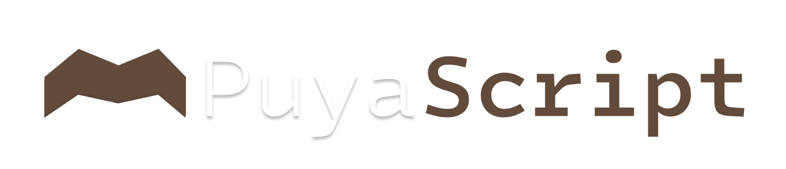

# PuyaScript — Documentación

PuyaScript es un lenguaje de programación interpretado, de sintaxis inspirada en la jerga andaluza. Hay dos intérpretes equivalentes, uno en Rust (`src/puyascript.rs`, el principal) y otro en Python 3 (`src/puyascript.py`). Ambos funcionan en tres fases: **lexer → parser (AST) → intérprete**.

---

## 1. Ejecución

### Con el ejecutable (Rust)
```bash
puyascript programa.puya
```
Para instalarlo en Linux x86_64: `bash instalador/instalar-puyascript.sh`. Para compilarlo tú mismo: `rustc -O src/puyascript.rs -o puyascript`.

### Con Python
```bash
python3 src/puyascript.py programa.puya
```

- El archivo **debe** tener extensión `.puya`, o el intérprete aborta con `¡Poriera! El archivo tiene que ser .puya`.
- Los errores se muestran como `Error fatal: <mensaje>` y el programa termina con código de salida 1. En la versión Rust van a `stderr`.
- Los errores propios del lenguaje empiezan por `¡Poriera!`.

---

## 2. Estructura básica

- Las sentencias terminan en `;`.
- Los bloques van entre llaves `{ }`.
- Los comentarios son de línea y empiezan por `//`.
- Se distinguen mayúsculas y minúsculas (`siAcaso` ≠ `siacaso`).
- Los identificadores admiten letras, dígitos y `_`, y no pueden empezar por dígito.

```puya
// Esto es un comentario
chivato("¡Ozú, qué calor!");
```

---

## 3. Tipos de datos

| Tipo     | Significado          | Ejemplo            |
|----------|----------------------|--------------------|
| `guita`  | Entero               | `42`               |
| `suelto` | Decimal (float)      | `3.14`             |
| `palique`| Texto (string)       | `"hola"`           |
| `fijo`   | Booleano             | `verdá` / `esIA`   |
| `peña`   | Lista / Arreglo      | `[10, 20, 30]`     |
| `na`     | Sin valor (retorno de funciones) | —      |

- `verdá` = verdadero, `esIA` = falso.
- Los textos van entre comillas dobles `"..."`. No hay secuencias de escape ni comillas dobles dentro de un texto. Un texto sin cerrar da error.
- Los números negativos se escriben con el operador `-` (`-5`, `-x`).
- Los arreglos (`peña`) se delimitan con corchetes `[...]` y sus elementos se separan por comas.

> Los tipos se usan al declarar, pero **no se comprueban** en ejecución: el intérprete no impide guardar un `palique` en una variable `guita`.

---

## 4. Variables

### Declaración
```puya
guita edad = 30;
suelto altura = 1.75;
palique nombre = "Manolo";
fijo contento = verdá;
peña numeros = [1, 2, 3, 4, 5];
```

### Asignación
```puya
edad = edad + 1;
numeros[0] = 10;
```
Asignar a una variable que no existe lanza `¡Poriera! No puedes asignar a '...': no existe.`

---

## 5. Listas y Arreglos (`peña`)

El tipo de dato `peña` permite almacenar colecciones ordenadas de elementos.

### Declaración e inicialización
```puya
peña notas = [9, 7, 10, 5];
peña nombres = ["Paco", "Maria", "Manolo"];
peña vacia = [];
```

### Acceso a elementos
Se accede a cada elemento usando índices de base 0 entre corchetes `[ ]`:
```puya
chivato(notas[0]); // Muestra 9
chivato(nombres[1]); // Muestra "Maria"
```

### Modificación de elementos
```puya
peña datos = [10, 20, 30];
datos[1] = 99;
chivato(datos); // Muestra [10, 99, 30]
```

Intentar acceder o modificar un índice fuera de los límites de la `peña` provocará un error de ejecución: `¡Poriera! Índice fuera de los límites de la peña.`

---

## 6. Operadores

| Categoría      | Operadores                         |
|----------------|------------------------------------|
| Aritméticos    | `+  -  *  /` y `-` unario          |
| Comparación    | `==  !=  <  >  <=  >=`             |
| Lógicos        | `estoY` (y), `estoO` (o), `noNiNa` (no) |

- `+` entre texto y cualquier otro valor **concatena** (convierte a texto).
- `/` siempre devuelve decimal (`7 / 2` → `3.5`).
- `noNiNa` y `-` son unarios y se aplican al operando que les sigue: `noNiNa contento`, `noNiNa (a > b)`, `-x`.
- `estoY` y `estoO` hacen cortocircuito: si el lado izquierdo basta, el derecho no se evalúa.

### Precedencia
De menor a mayor prioridad (a igual nivel, se evalúa de izquierda a derecha):

| Nivel | Operadores |
|-------|------------|
| 1 | `estoO` |
| 2 | `estoY` |
| 3 | `==  !=` |
| 4 | `<  >  <=  >=` |
| 5 | `+  -` |
| 6 | `*  /` |

Los paréntesis y corchetes de acceso a arreglos siempre tienen prioridad.

```puya
chivato(2 + 3 * 4);     // 14
chivato((2 + 3) * 4);   // 20
```

---

## 7. Salida: `chivato`

```puya
chivato("Hola");
chivato(5 * 2);
chivato(3 > 1);       // verdá
chivato([1, 2, 3]);   // [1, 2, 3]
```
Los booleanos se imprimen como `verdá` / `esIA`, los arreglos como `[elem1, elem2, ...]`, y una función sin retorno como `na`.

---

## 8. Condicionales: `siAcaso` / `siNo` / `oSiNo`

| Palabra   | Equivale a |
|-----------|------------|
| `siAcaso` | `if`       |
| `siNo`    | `else if`  |
| `oSiNo`   | `else`     |

```puya
siAcaso (nota >= 9) {
    chivato("Sobresaliente");
} siNo (nota >= 5) {
    chivato("Aprobado");
} oSiNo {
    chivato("Suspenso");
}
```
Las condiciones llevan paréntesis; las ramas siempre llevan llaves.

---

## 9. Bucles: `josear`

### Tipo `while`
```puya
guita i = 0;
josear (i < 5) {
    chivato(i);
    i = i + 1;
}
```

### Tipo `for`
```puya
josear (guita i = 0; i < 5; i = i + 1) {
    chivato(i);
}
```
- La inicialización debe empezar por un tipo (`guita`, `suelto`, `palique`, `fijo` o `peña`).
- El paso es una asignación (`i = i + 1`); no existe `i++`.

### Recorrer una `peña`
```puya
peña amigos = ["Paco", "Manolo", "Juana"];
josear (guita i = 0; i < 3; i = i + 1) {
    chivato("Un saludo a " + amigos[i]);
}
```

### Control de bucle
| Palabra        | Equivale a | Efecto |
|----------------|-----------|--------|
| `alCarajoPipa` | `break`    | Sale del bucle (o del `arteCaso`) |
| `tiraPalante`  | `continue` | Salta a la siguiente iteración    |

```puya
josear (guita i = 0; i < 10; i = i + 1) {
    siAcaso (i == 3) { tiraPalante; }
    siAcaso (i == 7) { alCarajoPipa; }
    chivato(i);
}
```

---

## 10. Selección múltiple: `arteCaso` / `caso`

Equivale a `switch`. **Tiene fall-through**: una vez que un `caso` coincide, se ejecutan los siguientes hasta encontrar `alCarajoPipa`. No existe `default`.

```puya
guita dia = 2;
arteCaso (dia) {
    caso 1:
        chivato("Lunes");
        alCarajoPipa;
    caso 2:
        chivato("Martes");
        alCarajoPipa;
    caso 3:
        chivato("Miércoles");
        alCarajoPipa;
}
```

---

## 11. Funciones: `movida` y `suelta`

```puya
movida nombre(tipo param1, tipo param2) -> tipoRetorno {
    ...
    suelta valor;
}
```

- `suelta` devuelve un valor (equivale a `return`).
- `-> tipo` es opcional; si se omite, es `na`. El tipo de retorno no se comprueba.
- Se pueden llamar como expresión o como sentencia (`saluda("Ana");`).
- Se admite recursividad.

```puya
movida suma(guita a, guita b) -> guita {
    suelta a + b;
}

movida factorial(guita n) -> guita {
    siAcaso (n <= 1) { suelta 1; }
    suelta n * factorial(n - 1);
}

movida saluda(palique quien) {
    chivato("Quillo, " + quien);
}

chivato(suma(2, 3));       // 5
chivato(factorial(5));     // 120
saluda("Paco");
```

---

## 12. Ámbito de variables

- Las variables globales son visibles desde las funciones.
- Cada llamada a función crea una memoria local con sus parámetros.
- **No hay ámbito de bloque**: una variable declarada dentro de un `siAcaso` o `josear` pertenece a la función (o al programa) que lo contiene.
- Una función solo ve sus propias variables y las globales; no ve las locales de quien la llamó.

---

## 13. Palabras reservadas

**En uso:**
`guita`, `suelto`, `palique`, `fijo`, `peña`, `na`, `verdá`, `esIA`, `chivato`, `siAcaso`, `siNo`, `oSiNo`, `josear`, `alCarajoPipa`, `tiraPalante`, `arteCaso`, `caso`, `movida`, `suelta`, `estoY`, `estoO`, `noNiNa`

**Reservadas sin uso actual** (reservadas para futuras versiones):
`trincar`, `banda`, `churumbel`, `poriera`, `esto`, `intocable`, `mamaDe`, `privao`, `palPueblo`, `roña`

---

## 14. Gramática resumida

```
programa     := sentencia*
sentencia    := declVar | asignacion | asignacionIndexada | llamada ';' | chivato 
              | siAcaso | josear | arteCaso | movida | suelta | alCarajoPipa ';'
              | tiraPalante ';'
declVar      := tipo ID '=' expresion ';'
asignacion   := ID '=' expresion ';'
asignacionIndexada := ID '[' expresion ']' '=' expresion ';'
chivato      := 'chivato' '(' expresion ')' ';'
siAcaso      := 'siAcaso' '(' expr ')' bloque
                ( 'siNo' '(' expr ')' bloque )* ( 'oSiNo' bloque )?
josear       := 'josear' '(' expr ')' bloque
              | 'josear' '(' tipo ID '=' expr ';' expr ';' ID '=' expr ')' bloque
arteCaso     := 'arteCaso' '(' expr ')' '{' ( 'caso' expr ':' sentencia* )* '}'
movida       := 'movida' ID '(' (tipo ID (',' tipo ID)*)? ')' ('->' tipo)? bloque
suelta       := 'suelta' expresion ';'
bloque       := '{' sentencia* '}'
expresion    := unaria ( operador unaria )*          // con precedencia (sección 6)
unaria       := ( 'noNiNa' | '-' ) unaria | primaria
primaria     := NUMERO | TEXTO | 'verdá' | 'esIA' | ID | ID '(' args ')'
              | '[' (expresion (',' expresion)*)? ']'
              | primaria '[' expresion ']'
              | '(' expresion ')'
```

---

## 15. Limitaciones conocidas

- **Sin `default`** en `arteCaso`.
- **Sin entrada de usuario**, objetos ni librería estándar.
- Los tipos declarados no se comprueban en ejecución.
- Los errores de ejecución (no los de lexer/parser) no indican línea.

---

## 16. Ejemplo completo con `peña`

```puya
// Ejemplo con peña y funciones
movida sumarPena(peña lista, guita tamano) -> guita {
    guita total = 0;
    josear (guita i = 0; i < tamano; i = i + 1) {
        total = total + lista[i];
    }
    suelta total;
}

peña misNumeros = [10, 20, 30, 40];
chivato("Valores originales: " + misNumeros);

// Modificar elemento de la peña
misNumeros[2] = 50;
chivato("Valores modificados: " + misNumeros);

guita resultado = sumarPena(misNumeros, 4);
chivato("La suma total es: " + resultado);
```